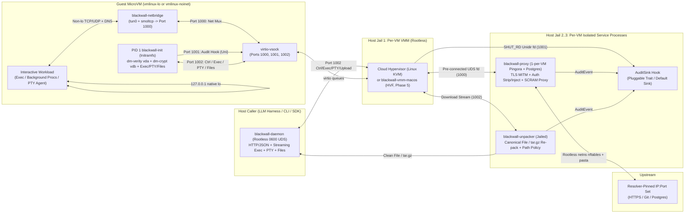

# Blackwall — System Architecture Specification

> **Core Premise:** Hardcore interactive sandbox isolation for LLM workloads on Linux servers/workstations (first) and Apple Silicon Macs (second) — assuming guest userspace, the guest Linux kernel, the VMM, Rust libraries, and Pingora all contain bugs, while treating only the **host hypervisor (`KVM` / `XNU + Hypervisor.framework`) and CPU silicon as the Trusted Computing Base (TCB)**.

See [API.md](file:///home/kibb/projects/personal/blackwall/docs/API.md) for the composable `SandboxSpec` profile format and HTTP-over-Unix-socket interactive session API.

---

## 1. Architectural Invariants

1. **Zero Implicit Host Trust Surfaces & 100% Rootless Linux Host:**
   - **No shared-memory filesystems** (`virtiofs`, `9p`, `vhost-user-fs` are forbidden).
   - **Host kernel never mounts guest-writable block devices** (eliminating `ext4`/`xfs`/`btrfs` metadata parser exploits against the host kernel).
   - **No kernel `vhost` data-plane drivers or TAP NICs** (`vhost-net`, `vhost-vsock`, `virtio-net` excluded to keep hypervisor kernel attack surface minimal).
   - **Zero root daemon on Linux:** `blackwall-daemon`, the VMM, `blackwall-proxy`, `pasta`, and `blackwall-unpacker` all run completely unprivileged under user/network/PID namespaces.
2. **Zero Secret Material Inside the Sandbox:**
   - Secrets are either sealed *at rest* (`seal1_<HPKE_X25519>`) in profile TOML or passed ephemerally over the `0600` local Unix socket on `POST /v1/sandboxes`, and held exclusively inside that VM's dedicated jailed **`blackwall-proxy`** (`memfd_secret` on Linux / `mlock` on macOS).
   - The guest receives only a **cryptographically random per-VM placeholder** shaped to satisfy client SDK format checks (e.g., `ghp_bw00<random>`), carrying zero cryptographic relationship to the real secret.
3. **Mandatory Upstream Identity Pinning:**
   - On any `[[network.http]]` rule with an `auth` block, `blackwall-proxy` unconditionally **strips all guest-supplied authentication** and **forces the brokered credential** — preventing a compromised guest from exfiltrating data to an allowlisted SaaS API (e.g., `api.github.com`) using an attacker-controlled token.
4. **Clean, Non-Destructive File I/O (No Blind Host Writeback):**
   - Only **2 disks** per VM (`vda` immutable OS image, `vdb` ephemeral encrypted `/workspace`) and **one clean `upload` / `download` (`file` or `tar.gz`) primitive** over `Port 1002`.
   - Extracted files and `.tar.gz` archives pass through a jailed **`blackwall-unpacker`** that enforces size/file caps, rejects `..`/symlinks/hardlinks/devices/setuid, canonically re-packs archives, and enforces case/Unicode-normalized `deny_touch_globs` whenever unpacking onto host disk.
5. **Clear Separation of Containment vs. Detection:**
   - Hard containment lives strictly outside the VM (hypervisor, VMM jail, per-VM Pingora + kernel `nftables` IP-sets, jailed `blackwall-unpacker`).
   - Observability/audit exposes clean pluggable hooks (`AuditSink` trait + unidirectional `Port 1001` framing) so optional in-guest BPF LSM sensors, Merkle spools, or remote `immudb` backends can be attached later without coupling them to core isolation.

---

## 2. End-to-End System Topology



---

## 3. Platform Matrix: Linux (Primary) vs. Apple Silicon macOS (Phase 5)

Guest userland (`blackwall-init`, `blackwall-netbridge`), `erofs+dm-verity`, `dm-crypt`, `blackwall-proxy`, `blackwall-unpacker`, and `blackwall-daemon` are shared across platforms. Linux KVM ships end-to-end first; Apple Silicon HVF follows in Phase 5:

| Layer / Feature | Modern Linux (`x86_64` / `aarch64`) — Primary | Apple Silicon Mac (`aarch64-apple-darwin`) — Phase 5 |
| :--- | :--- | :--- |
| **Trusted Computing Base (TCB)** | Host Linux kernel (`/dev/kvm`) + CPU/IOMMU silicon | macOS XNU kernel + `Hypervisor.framework` + Apple Silicon |
| **Host Privilege Model** | **100% Rootless** (no root daemon, no `sudo`, no setuid) | Unprivileged VMM/proxy under Seatbelt; optional privileged helper only if host `pf` anchoring is enabled |
| **VMM Implementation** | **`cloud-hypervisor`** (userspace `virtio-blk`, `virtio-vsock`, `virtio-rng`, `virtio-console`; opportunistically enables **AMD SEV-SNP** / **Intel TDX** when supported) | **`blackwall-vmm-macos`** (built on `libkrun` / `rust-vmm` HVF + `virtio-mmio` crates; signed with `com.apple.security.hypervisor`) |
| **VMM Jail & `vsock` Bootstrap** | Applied **pre-`exec`**: empty `CLONE_NEWNET`, `CLONE_NEWUSER`, `CLONE_NEWPID`, `pivot_root` into an empty tmpfs with a single bind-mounted `vsock-dir/`, Landlock, `PR_SET_DUMPABLE=0`, `PR_SCHED_CORE`, and `seccomp-bpf` (`accept4` allowed, `connect()` denied). Orchestrator connects `CONNECT 1000/1001/1002\n` and immediately unlinks `vsock.sock`. | Pre-opened `socketpair(AF_UNIX, ...)` fds + `hv_vm_create`/`hv_vcpu_create` initialized before locking process under Seatbelt `(version 1) (deny default)` (no `file-*`, `network*`, or Mach lookups). |
| **Ephemeral Scratch Backing (`vdb`)** | `open(..., O_TMPFILE \| O_RDWR, 0600)` + `ftruncate()` | `mkstemp()` in `0700` private dir + immediate `unlink()` + `ftruncate()` before Seatbelt lock |
| **Per-VM `blackwall-proxy` Jail** | Dedicated rootless process per VM inside its own `CLONE_NEWUSER + CLONE_NEWNET + CLONE_NEWPID` bridged via **`pasta`**. Setup helper installs `nftables` egress IP-set (blocks `127.0.0.0/8`, `169.254.169.254`, RFC1918, and non-allowlisted IPs), then drops all caps (`PR_SET_NO_NEW_PRIVS=1`), sets `PR_SET_DUMPABLE=0`, installs Landlock + `seccomp-bpf` (blocking `unshare`/`setns`/netlink so compromised Pingora cannot alter its own `nftables`), and `exec`s Pingora with secrets in `memfd_secret(0)`. | Dedicated unprivileged process per VM under Seatbelt `(deny file-read* file-write*)` + optional `pf` IP:port allowlist; secrets held in `mlock()` + zeroize memory. |
| **Base Image (`vda`) Builder** | Uses `docker build`/`podman build` (build-time only) for declarative `[image]` (`base`/`packages`/`run`) or existing OCI images -> strips setuid/caps -> `mkfs.erofs` + `veritysetup` (zero Docker at VM runtime) | Pure-Rust `erofs` + `dm-verity` writer in `blackwall-oci` (zero Linux CLI dependencies) |

---

## 4. `vsock` Channel Bootstrap & Multiplexing

Why host-initiated channels instead of guest-initiated `vsock`?
- In `cloud-hypervisor`, guest-initiated `AF_VSOCK` connections require the VMM to call `connect("/path/vsock.sock_<port>")` on the host filesystem, conflicting with a `connect()`-denied jail.
- Instead, `blackwall-init` (PID 1 in the guest initramfs) calls `listen()` on three `AF_VSOCK` ports at early boot. The host orchestrator initiates **three persistent connections** during the `Handshake` state, then unlinks `vsock.sock`:

1. **Port 1000 (`NET_MUX`, bidirectional):** Length-prefixed stream multiplexer (`12-byte` header: `StreamID: u32`, `PayloadLen: u32 <= 64 KiB`, `Flags: u8`, `StreamType: u8`, `Reserved: u16`) handed directly to that VM's dedicated `blackwall-proxy` process. *(Framing isolates stream boundaries only; TLS/HTTP/SQL parser isolation relies on running one jailed `blackwall-proxy` process per VM.)*
2. **Port 1001 (`AUDIT_UNI`, guest -> host one-way):** After handshake, the host calls `shutdown(fd, SHUT_WR)`, enforcing kernel-level unidirectional data flow into the pluggable `AuditSink` hook.
3. **Port 1002 (`CTRL_SESSION`, bidirectional):** Delivers boot config (`vda` `dm-verity` roothash, session env, random secret placeholders, network config) and multiplexes interactive session RPCs: `exec` (sync/streaming/background), PTY streams, `upload` (file/tar into `/workspace`), and `download` (file/`tar.gz` out to `blackwall-unpacker`).

---

## 5. 2-Disk Storage & Single Upload/Download File I/O

```text
Base OCI image (built once) ──► strip setuid/caps ──► erofs + dm-verity ──────► vda (ro, /)
Unlinked host file (O_TMPFILE) ──► guest 256b RNG dm-crypt + ext4 ────────────► vdb (rw, /workspace)
Host -> VM (optional): PUT /files (file | tar) ──► Port 1002 ─────────────────► /workspace
VM -> Host (optional): /workspace ──► Port 1002 ──► jailed blackwall-unpacker ► clean file | tar.gz
```

Why this 2-disk design beats per-run `gix` / `overlayfs` / `git-patch` staging:
1. **No `git` assumption:** A sandbox may start completely empty (agent clones a repo or writes code from scratch), receive a single file or tar via `PUT /files`, commit & push out over `blackwall-proxy`, or export a file / `.tar.gz` via `GET /files`.
2. **No `overlayfs` on `/workspace`:** `/workspace` is a clean native `ext4` on encrypted `vdb`, avoiding overlayfs whiteout/`d_type`/hardlink quirks with build tools, `git`, and local databases.
3. **No per-run `erofs` build latency:** `vda` is built once per base image and shared read-only across all VMs. Uploading a 50 MB workspace over `virtio-vsock` (~1–3 GB/s) takes ~30ms. Client/CLI upload helpers may optionally filter local secrets (`.env`, `.git/config`, `target/`, `node_modules/`) before streaming.
4. **Hardened extraction (`blackwall-unpacker`):** Every `GET /files` stream from the guest passes through an unprivileged jailed host process that:
   - Enforces `export.max_bytes` and `export.max_files` (zip-bomb protection).
   - Rejects `..` path traversal, absolute paths, symlinks, hardlinks, FIFOs, device nodes, and setuid/setgid bits.
   - **Canonically re-packs** `.tar.gz` archives so downstream host tooling never parses raw guest-crafted archive bytes.
   - Normalizes **ASCII case and Unicode (NFC/NFD)** before checking `deny_touch_globs` (preventing `.GitHub` / `.ENVRC` / `.Cargo/config.toml` bypasses on case-insensitive filesystems) whenever unpacking onto host disk.

*(Optional future extension: read-only `erofs` block device attachment for multi-GB immutable datasets via `[[volumes]]` in `SandboxSpec`, strictly read-only.)*

---

## 6. Guest Networking (`vmlinux-lo` + `tun0`/`smoltcp` vs. `vmlinux-noinet`)

Policy profiles select one of three networking modes (`network.mode`):

### Mode 1: `loopback` (Built-In `base` Default — Offline + Local Tests)
- **Kernel (`vmlinux-lo`):** Minimal `CONFIG_INET=y` with **zero hardware/virtio NICs, `CONFIG_NETFILTER=n`, `CONFIG_PACKET=n`, `CONFIG_XFRM=n`, `CONFIG_IO_URING=n`**, and `CONFIG_SYSVIPC=y` (in isolated `CLONE_NEWIPC` for local PostgreSQL).
- **100% Native Loopback, Zero Egress:** `127.0.0.1`, `::1`, `0.0.0.0`, local PostgreSQL/Redis, `cargo test`, and `pytest` work natively on `lo` — with **no `blackwall-netbridge`, no `blackwall-proxy`, and no `pasta` spawned**.

### Mode 2: `egress` (Interactive Sandbox with Allowlisted Upstream APIs)
- **Kernel (`vmlinux-lo` + `CONFIG_TUN=y`):** Same native loopback baseline, plus `blackwall-netbridge` bridging non-loopback traffic to the per-VM `blackwall-proxy`:
  - `blackwall-init` brings up an in-guest `tun0` device (`198.18.0.1/15`) with synthetic DNS (`198.18.0.53`) and a default route into `tun0` (satisfying `AI_ADDRCONFIG` / `NETLINK_ROUTE` checks automatically).
  - `blackwall-netbridge` terminates guest TCP/UDP packets arriving on `tun0` using **`smoltcp`** in userspace:
    - DNS queries to `198.18.0.53:53` resolve hostnames derived automatically from `[[network.http]]` + `[[network.postgres]]` through `Port 1000` -> `blackwall-proxy` and return deterministic RFC 2544 synthetic IPs (`198.18.x.y`).
    - TCP connections to `198.18.x.y:<port>` open multiplexed streams over `Port 1000` -> `blackwall-proxy`.
  - Works identically for static binaries, raw syscalls, Go, Rust, Python, Node, and `psql` with **zero `seccomp_unotify` overhead or compatibility cliffs**.

### Mode 3: `none` (Maximum-Hardening Offline Workers)
- **Kernel (`vmlinux-noinet`):** `CONFIG_INET=n`, `CONFIG_IPV6=n`, `CONFIG_TUN=n`. Every `AF_INET`/`AF_INET6` syscall (including `127.0.0.1`) fails immediately with `EAFNOSUPPORT`. Zero network stack, zero `netbridge`, zero proxy.

---

## 7. Per-VM Pingora Proxy, Secret Brokering & Postgres Wire Proxy

Each VM with `network.mode = "egress"` gets its own dedicated rootless jailed **`blackwall-proxy`** process:

1. **Out-of-Process DNS + Exact IP Dialing:**
   - The host orchestrator resolves the allowlisted FQDNs (derived automatically from `[[network.http]]` and `[[network.postgres]]`) outside the proxy jail, populates the proxy's locked `nftables` IP-set, and passes the **exact resolved IP addresses** to `blackwall-proxy`.
   - `blackwall-proxy` dials those pinned IPs directly (never re-resolving DNS internally), preventing both DNS rebinding and CDN IP-rotation mismatches against `nftables`.
2. **Pingora HTTP/1.1 & HTTP/2 + Dynamic SNI TLS MITM:**
   - Demultiplexed `Port 1000` TLS streams feed Pingora with an ephemeral per-VM ECDSA P-256 MITM CA (injected into the guest trust store at boot).
   - Enforces per-host `methods`, `path_prefixes`, and `max_request_bytes`, streaming SSE/chunked LLM responses without whole-body buffering.
3. **Zero-Secret-in-Guest & Mandatory Auth Pinning:**
   - Real secrets (`seal1_...` opened with the host HPKE private key, or `ephemeral` socket secrets) live strictly inside `blackwall-proxy`'s `memfd_secret(0)` memory.
   - Whenever an `[[network.http]]` rule declares `auth`, Pingora verifies the guest presented its assigned random placeholder (preventing ambient confused-deputy calls), **strips all guest-supplied auth headers/cookies** (`Authorization`, `Cookie`, `X-Api-Key`, `Proxy-*`, `x-amz-*`), and injects the real secret using the rule's `kind` (`bearer`, `header`, or `basic` for `git clone`/`git push` HTTPS).
4. **Sibling PostgreSQL Wire Proxy (`:5432`):**
   - Runs alongside Pingora inside the same per-VM jailed `blackwall-proxy` binary on Tokio.
   - **Downstream (Guest <-> Proxy over `vsock`):** Negotiates Postgres `SSLRequest` (`'S'`) with the per-VM CA, then sends `AuthenticationCleartextPassword` (`'R'`, type `3`) to validate the guest's random `PGPASSWORD` placeholder.
   - **Upstream (Proxy <-> Real Postgres):** Connects to the pinned IP over TLS (`sslmode=verify-full`) and authenticates with **`SCRAM-SHA-256`** using the real DB password from `memfd_secret`.
   - Emits structured SQL audit events from Frontend `'Q'`/`'P'`/`'B'`/`'E'` frames; hard data/DDL containment is enforced by upstream PostgreSQL `ROLE` grants and Row-Level Security (RLS).

---

## 8. Pluggable Observability & Audit Hooks

Rather than coupling MVP to eBPF or external ledger daemons, Blackwall defines clean, zero-overhead **extension hooks**:
- **`blackwall-audit` Traits (`AuditSink` + `AuditEvent`):** Strongly typed events emitted at every authoritative host boundary (`SandboxLifecycle`, `ExecCommand`, `FileTransfer`, `HttpRequest`, `AuthMismatch`, `PostgresQuery`, `UnpackerRejection`, `VmmFatalExit`) plus raw guest-originated telemetry arriving on unidirectional `Port 1001`.
- **MVP Default:** Ships with a no-op / structured JSONL sink only — zero external daemons, zero BPF build dependencies in Phases 1–4.
- **Future Pluggable Backends (Phase 6+):** In-guest `blackwall-ebpf` (Aya `BPF_PROG_TYPE_LSM` / `tp_btf` compatible with `lockdown=confidentiality` draining to `Port 1001`), local BLAKE3 RFC 6962 Merkle spool, and remote `immudb` (`VerifiableExecAll`) witnessing plug directly into `AuditSink`.

---

## 9. VM Lifecycle & Warm Pre-Booted Pool (Phase 6)

- **Default (Cold Boot, ~80–150ms):** `vmlinux-lo` / `vmlinux-noinet` boots into `blackwall-init`, maps `dm-verity` `vda`, initializes random-keyed `dm-crypt` `vdb` at `/workspace`, and serves interactive commands for the lifetime of the session (`idle_timeout_sec` + `max_wall_time_sec`). Subsequent `exec` calls inside a live session take `<2ms`.
- **Phase 6 Warm Pool (`<15ms` Dispatch):** Because of the 2-disk model, warm pooling is trivial — each pooled VM is independently cold-booted (unique kernel ASLR + unique `dm-crypt` scratch key) with `vda` and an empty encrypted `/workspace` (`vdb`) already mounted and paused at `Handshake`. On claim, `blackwall-daemon` attaches the per-VM proxy + `Port 1002` session config and optionally streams initial files into `/workspace`.
